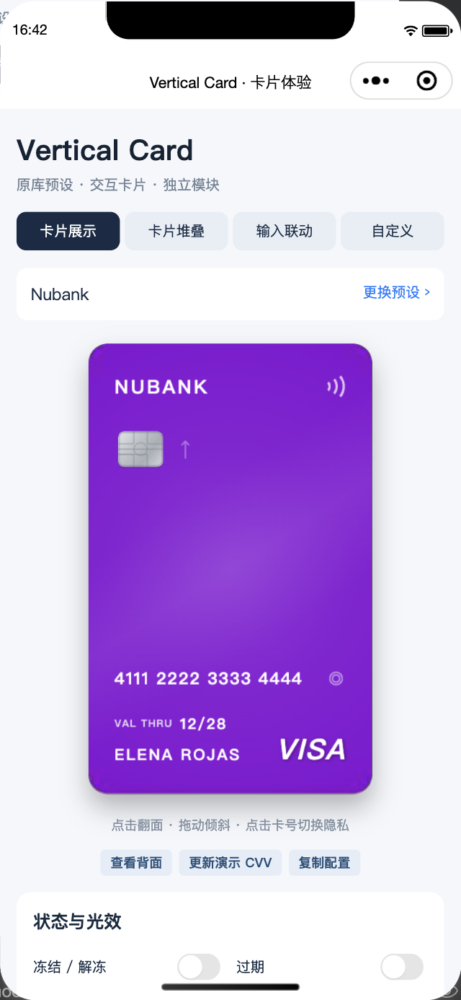

# Vertical Credit Card Mini Program

微信小程序原生竖版信用卡组件。基于 [ClevesDev/vertical_credit_card](https://github.com/ClevesDev/vertical_credit_card) 0.0.5 移植，独立项目，非上游官方版本。

从 `vertical_credit_card` 0.0.5 移植，保留 MIT 许可。模块不依赖余额记账业务，可以整体复制到其他使用 WebView 渲染的小程序。



## 组件与功能

| Flutter 原组件 | 小程序实现 | 能力 |
| --- | --- | --- |
| VerticalCard / CardFront / CardBack | `card/card` | 550 ms 正反翻面、外部控制翻面、隐私、倾斜与回弹、冻结/解冻、过期、品牌检测、插槽 |
| VerticalCardTheme / CardPresets | `model.ts` / `themes.ts` / `presets.ts` | Flat、Metallic、Glass、Artistic，46 个原预设条目（含两个别名） |
| 各种背景 Painter | `assets/` | 从原 Flutter 绘制结果导出，保留原纹理、芯片和防伪贴；品牌使用原生文字和图形实现 |
| 动态 Painter | `effects.ts` / `glitter.ts` | 原四球流体轨迹、3.2 秒边缘光束、RGB、倾斜相关钻石闪光、全息、镜面反光、900 ms 非接触脉冲 |
| VerticalCardStack | `stack/stack` | 堆叠、选中展开、再次点击收起、原位置和缩放规则 |
| VerticalCardInputForm | `input-form/input-form` | 卡号分组、有效期格式化、品牌检测、CVV 聚焦/失焦联动翻面 |
| RollingDigitText | `rolling-digit/rolling-digit` | 数字向前滚动、650 ms 基础时长、45 ms 逐位错峰，其他字符保持静止 |

小程序使用原生 WXML/WXSS/TypeScript、Canvas 2D 和 CSS 3D；不包含 Flutter 运行时。静态 Painter 以本地图片保存，动态效果使用小程序绘图。WebView 与 Flutter 的字体栅格化、混合模式和弹簧曲线存在平台差异，不能保证像素级完全相同。SVG/自定义 Flutter Widget 需通过小程序插槽或背景图片替代。

## 接入

页面 JSON：

```json
{"usingComponents":{"vertical-card":"/modules/vertical-credit-card/card/card"}}
```

页面 WXML：

```xml
<vertical-card preset="goldPrestige" bank-name="招商银行" card-holder="账户名称"
  card-number="4111 2222 3333 4444" expiry-date="12/28" cvv="123"
  width="240" is-privacy-mode="{{true}}"
  bind:flipchange="onFlip" bind:privacychange="onPrivacy" />
```

公开属性沿用原库命名，WXML 使用短横线连接，例如 `isFrozen` → `is-frozen`、`enable3DTilt` → `enable-3-d-tilt`。可传入 `card-theme` 自定义对象；`themes.ts` 提供四类主题工厂。光效属性默认 `null`，沿用主题值；显式传入布尔值覆盖主题。

事件 `flipchange`、`privacychange`、`cardselected` 的 `detail.value` 分别为翻面状态、隐私状态、选中索引（收起时为 `null`）；`cardtap` 为普通点击。

插槽：`bank-logo`、`chip`、`action-badge`、`balance`。传入自定义银行 Logo 或芯片时设置 `use-bank-logo` / `use-chip-widget` 为 `true`，隐藏对应默认内容。

体验页面：`/modules/vertical-credit-card/demo/demo`，可体验全部预设、状态、光效、钱包堆叠、输入联动、自定义及复制外观配置。

## 运行演示

```sh
git clone git@github.com:Crazy-MT/vertical-credit-card-miniprogram.git
cd vertical-credit-card-miniprogram
npm ci
npm test
```

微信开发者工具导入仓库根目录，填写自己的小程序 AppID 后打开演示。仓库默认使用 `touristappid` 占位；部分开发者工具版本不支持该占位值，需要有效 AppID。无需余额记账项目或云服务，渲染模式为 WebView。

复制 `miniprogram/modules/vertical-credit-card` 到目标小程序同一路径即可接入；图片使用绝对模块路径，移动目录时需同步调整素材引用。完整演示包含卡片、堆叠、输入联动和自定义主题。所有示例卡号均为演示数据，输入只保留在页面内存中。

## 素材再生成

```sh
sh scripts/export-vertical-card-assets.sh ../vertical_credit_card
```

需要 macOS、Flutter、Python 3 与 sips；`FLUTTER_BIN` 可指定 Flutter。运行小程序无需 Flutter。图片资源总计约 196 KB。

## 许可与来源

采用 MIT 许可证，保留原作者 ClevesDev 的版权声明，见 [LICENSE](LICENSE)。纹理素材由原库 Painter 导出，动态效果依据原库算法移植。品牌名称及标识仅用于组件展示，其商标归各自权利人所有；本项目不代表任何银行或支付品牌。

## 验证

`npm test` 检查 TypeScript、46 个预设资源、品牌边界、卡号与有效期格式化及隐私显示。2026-10-11 在微信开发者工具中验证了独立演示页、翻面和堆叠，未重新进行真机验收。
